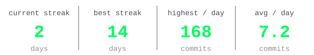

# GitHub Stats Generator

Generates dark-themed SVG cards for your GitHub profile README - responsive across desktop and mobile.

---

## Preview

<br />

<p align="center"><strong>Stats</strong> - years experience · total commits · total stars</p>

<p align="center">
<picture>
  <source media="(max-width: 420px)" srcset="assets/stats/stats-420px.svg">
  <source media="(max-width: 640px)" srcset="assets/stats/stats-640px.svg">
  
</picture>
</p>

<br />

<p align="center"><strong>Metrics</strong> - current streak · best streak · highest commits/day · avg commits/day</p>

<p align="center">
<picture>
  <source media="(max-width: 420px)" srcset="assets/metrics/metrics-420px.svg">
  <source media="(max-width: 640px)" srcset="assets/metrics/metrics-640px.svg">
  
</picture>
</p>

---

## Setup

### 1. Create a Personal Access Token

Go to **GitHub → Settings → Developer Settings → Personal access tokens → Tokens (classic)** and create a token with:

- `public_repo`
- `read:user`

### 2. Add the token as a repository secret

In your profile repository go to **Settings → Secrets and variables → Actions** and add:

| Name          | Value                  |
|---------------|------------------------|
| `STATS_TOKEN` | your token from step 1 |

### 3. Add the workflow

Create `.github/workflows/stats.yml` in your profile repository:

```yaml
name: Update Stats

on:
  schedule:
    - cron: '0 2 * * *'  # Every day at 02:00 UTC
  workflow_dispatch:

jobs:
  update:
    runs-on: ubuntu-latest
    permissions:
      contents: write

    steps:
      - uses: actions/checkout@v7

      - uses: developer-samuel/github-stats-generator@v1
        with:
          token: ${{ secrets.STATS_TOKEN }}
          username: ${{ github.repository_owner }}
          start_date: '2020-01-01'  # Optional: YYYY-MM-DD

      - name: Commit changes
        run: |
          git config user.name "github-actions[bot]"
          git config user.email "github-actions[bot]@users.noreply.github.com"
          git add assets/ README.md
          git diff --cached --quiet || (
            git commit -m "chore: update profile stats" &&
            git push
          )
```

### 4. Add the cards to your README

Add these two lines to your profile `README.md` - the action automatically converts them to responsive `<picture>` elements on every run:

```bash
echo '' >> README.md
echo '' >> README.md
```

- **Stats** - years experience · total commits · total stars
- **Metrics** - current streak · best streak · highest commits/day · avg commits/day

To skip README auto-updating, set `readme_path: ''` in the workflow inputs.

---

## Inputs

| Input           | Required | Default    | Description                                                                   |
|-----------------|----------|------------|-------------------------------------------------------------------------------|
| `token`         | ✅       | -          | PAT with `public_repo` + `read:user`                                          |
| `username`      | ✅       | -          | GitHub username - use `${{ github.repository_owner }}`                        |
| `output_dir`    | -        | `assets`   | Base output folder - `stats/` and `metrics/` subfolders created automatically |
| `readme_path`   | -        | `README.md`| File to auto-update with responsive `<picture>` elements (set `''` to skip)   |
| `start_date`    | -        | -          | Programming start date `YYYY-MM-DD` - shows *years experience* stat           |
| `theme`         | -        | `dark`     | `dark` or `light`                                                             |
| `primary_color` | -        | -          | Accent color (hex) - overrides theme                                          |
| `bg_color`      | -        | -          | Background color (hex or `none` for transparent) - overrides theme            |
| `text_color`    | -        | -          | Secondary text color (hex) - overrides theme                                  |
| `muted_color`   | -        | -          | Label color (hex) - overrides theme                                           |
| `divider_color` | -        | -          | Divider line color (hex) - overrides theme                                    |

---

## Themes

### Dark (default)

| Key       | Color     |
|-----------|-----------|
| `primary` | `#01ff5e` |
| `bg`      | `none`    |
| `text`    | `#8b949e` |
| `muted`   | `#484f58` |
| `divider` | `#21262d` |

### Light

| Key       | Color     |
|-----------|-----------|
| `primary` | `#01ff5e` |
| `bg`      | `none`    |
| `text`    | `#57606a` |
| `muted`   | `#6e7781` |
| `divider` | `#d0d7de` |

Individual color inputs override the theme. For example:

```yaml
theme: dark
primary_color: '#f78166'
```

---

## Related

- [DEVELOPMENT.md](DEVELOPMENT.md) - local dev setup, tooling and task runner
